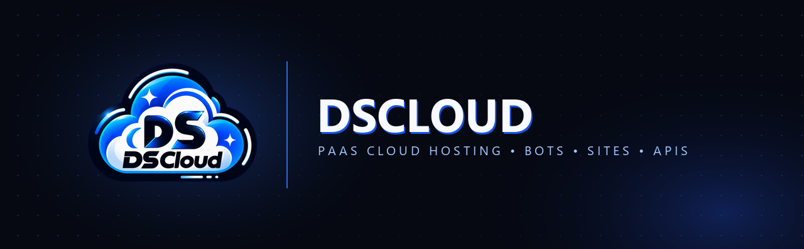



  

<h1 align="center">DSCloud</h1>

  <strong>Your all-in-one PaaS cloud hosting platform for bots, websites, and APIs — deploy via Git, ZIP, or CLI with instant panel control.</strong>

  
  
  
  

---

### What we build
- **PaaS Application Hosting:** Deploy bots, websites, and APIs in seconds via **Git**, **ZIP**, or **CLI** with real-time logs and panel management.
- **Multi-Runtime & Databases:** Native support for **Node.js**, **Python**, **TypeScript**, **Go**, **Rust**, **Next.js**, **Bun**, **Deno**, **.NET**, and **Elixir**, paired with **PostgreSQL**, **MySQL**, **MongoDB**, and **Redis**.
- **Developer Ecosystem:** Official SDKs, CLI tooling, and REST API (`@dscloud/sdkapi`) built for automation and CI/CD workflows.

### Links
- Website: https://dscloud.pt
- Documentation: https://docs.dscloud.pt
- JavaScript SDK: https://github.com/dscloudcampany/SdkApiJS
- Support: `support@dscloud.pt`
